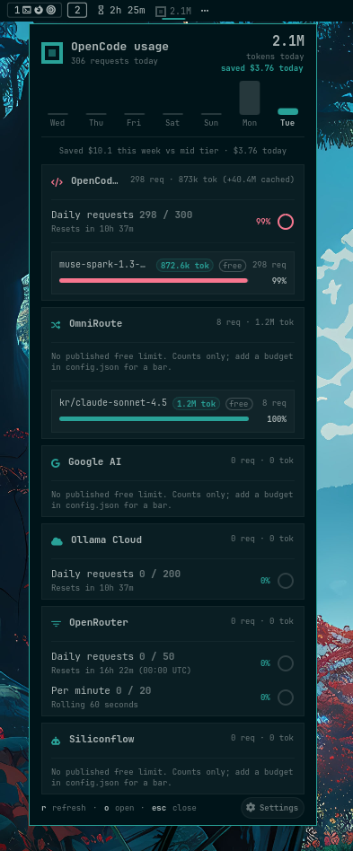
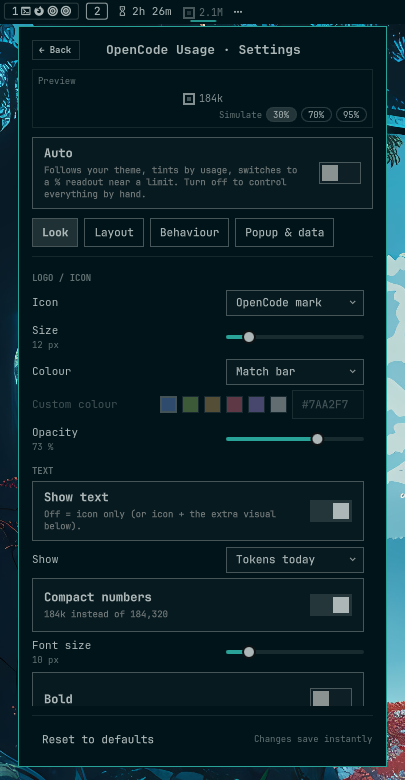
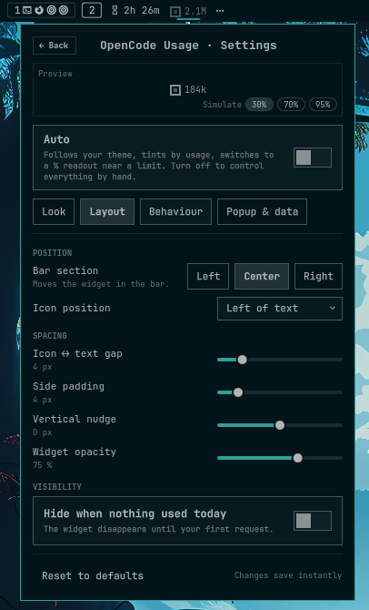
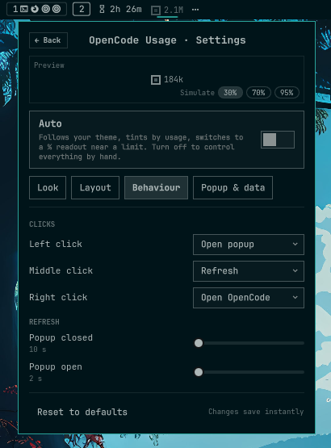
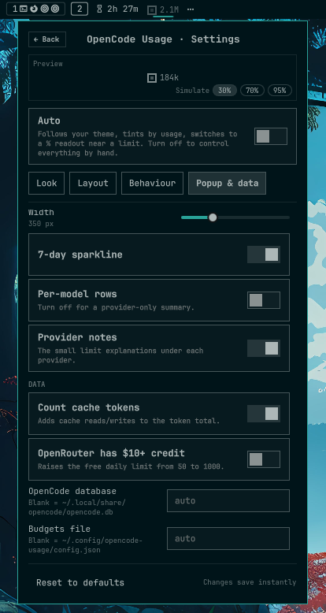

# opencode-usage

how much free tier AI have you burned through today? little widget for the
[omarchy](https://omarchy.org) bar



## what you get

- :bar_chart: today's tokens in the bar - fresh tokens up front,
- :moneybag: how many $$$ of paid API calls your free traffic replaced
- :sparkles: 7-day sparkline, per-provider free-tier limit rings, per-model rows
- :gear: settings for basically everything, changes apply instantly
- :mouse: left-click opens/closes, middle-click refreshes, right-click
  (or `o`) opens opencode - logo turns amber at 60% of any limit, red at 85%

### settings

<table>
<tr>
<td align="center"><br><b>look</b> - icon, size, colour, text</td>
<td align="center"><br><b>layout</b> - bar section, spacing, visibility</td>
</tr>
<tr>
<td align="center"><br><b>behaviour</b> - clicks, refresh timing</td>
<td align="center"><br><b>popup & data</b> - width, rows, budgets, db path</td>
</tr>
</table>

## install

```sh
omarchy plugin add https://github.com/paudelsamir/opencode-usage.git --enable
```

<details>
<summary><b>install by hand instead</b></summary>
<br>

drop this folder into `~/.config/omarchy/plugins/`, then

```sh
omarchy-shell shell rescanPlugins
omarchy plugin enable paudelsamir.opencode-usage
```

</details>

## remove

```sh
omarchy plugin disable paudelsamir.opencode-usage
omarchy plugin remove paudelsamir.opencode-usage
```

## needs

| dependency | why |
|---|---|
| [opencode](https://opencode.ai) 1.x | reads its local database (`~/.local/share/opencode/opencode.db`) - read-only, no network, no API keys, nothing leaves your machine |
| `python3` (stdlib only) | the `bin/opencode-usage` data script |
| [models.dev](https://models.dev) catalog | prices - opencode already caches it at `~/.cache/opencode/models.json` |

- overrides (`baseline`, `equivalents`, `free`, `paid`) go in
  `~/.config/omarchy/agents/opencode.json`.


> [!NOTE]
> Only OpenCode 1.x's `message` table is read; OpenCode 2 beta will show an error.
